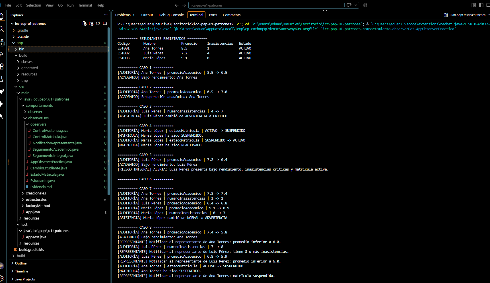

## Explicación de mi práctica Observer
En esta pracita hcimos un sistema de par monitorear los cambios de datos de 3 estudiantes, se utilizo el patron oberserver para que cuando se modifique un dato los obervadores reciban el aviso y avisen si deben mostrar algun mensaje
### Clases qu use
Estudiante este guarda los datos del estudiante y cuando un dato cambia crea un evento y avisa a sus observadores, is el valo r es el mismo no pasa nada 
Cambio estudiante es un record que guarda el estudiante y atributo modificado, el valor anterior y el nuevo
estado matricula contiene los estados activo, suspendido, retirado.
appobserverpracticca, crea los estudiantes y los obervadores y los ejecuta 

### Observer 
En la carpeta obervers estan los controloes o por decirlo asi los oberservers 
#### SeguimientoAcademico:
 avisa cuando el promedio baja de 7 y
cuando el estudiante se recupera.
#### ControlAsistencia: 
identifica los niveles normal, advertencia y
crítico según las inasistencias.
####  ControlMatricula: 
informa cuando el estudiante es suspendido,
retirado o reactivado.
#### SeguimientoIntegral:
 genera una alerta si el estudiante tiene
promedio menor a 7, seis o más inasistencias y matrícula activa.
#### NotificadorRepresentante: 
es el observador adicional,notifica
si el promedio baja de 6, si llega a 8 inasistencias o si la
matrícula cambia a suspendida.
### Evidencia de ejecución
