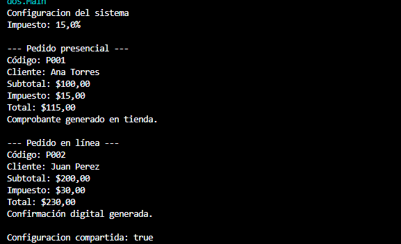

# Gestion de Pedidos
Andres Eduardo Mendez
## Patrones utilizados

### 1. Singleton

Utilice principalmete el singleton ya que nos pedia en el ejercicio una sola instancia ya que  la empresa requiere que exista una única instancia responsable de administrar dicha configuración y este patron nos da esa posibilidad, esto esta en la clase ConfiguracionSistema

### 2. Factory Method
Elegi tambien el Factory Method ya que aqui se usa el Creador y producto en este caso me ayuda este patron de creacion.
Aqui mi Factory Method es crearPedido() y es el que esta junto al abstract de la clase Creador Pedido que es el creador abstracto
Se utiliza para crear pedidos presenciales y en linea sin tener q cambiar mucho el codigo principa, esto facilita agregar nuevos tipos de pedidos.
Aqui agregue un creador abstracto que es Creador de pedidos cuando creamos su clase indicamos que es abstracta y a continuacion cree los creadores concretos que son CreadorPresencial y Creador en Linea estos implementan el CreadorPedido

## Clases

Producto Abstracto:
- Pedido: contiene los datos y calculos
Productos Concretos:
- PedidoPresencial: genera el comprobante en tienda
- PedidoEnLinea: genera la confirmacion digita
- ConfiguracionSistema: guarda el impuesto
Creadore Abstacto
- CreadorPedido: define como crear pedid
Creadores Concretos
- CreadorPedidoPresencial: crea pedidos presenciales
- CreadorPedidoEnLinea: crea pedidos en linea
- Main: hice otro main que ejecuta el programa ya que el otro estaba ocupado por los otros metodos

## Funcionamiento

El impuesto es del 15%.

- Pedido presencial: $100 + $15 = $115.
- Pedido en linea: $200 + $30 = $230.

Al final aparece true, lo q demuestra q la configuracion es compartida.

