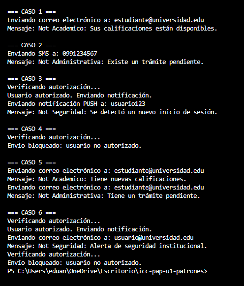

### Practica 2: Patrones de Diseño Estructurales – Bridge y Proxy
El patron Bridge  nos permite combinar diferentes tipos de notificaciones con distintos canales de comunicación sin necesidad de crear itras clases para cada combinación.

El patron Proxy verifica la autorización antes de permitir que el canal real ejecute el envío.

De esta manra, cada clase mantiene una responsabilidad específica y  evita duplicar la lógica de autorización en los canales originales.

