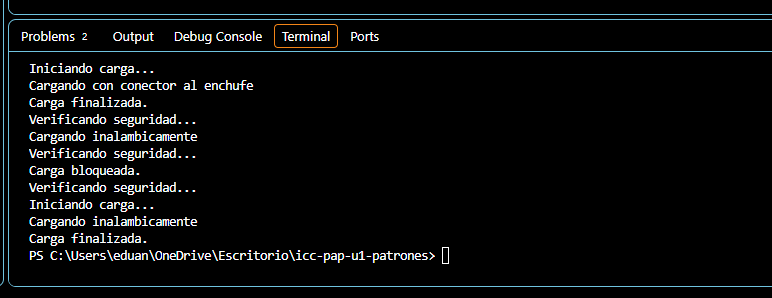

# Patrón Decorator aplicado a Adapter

## Explicación

En esta practica aplique el patron decorador al ejemplo de cargadores que desarrollamos con el patron adaptador 
El patron adaptador nos permite utilizar cargador antiguo con el cargador inalambrico mediante la interface Cargador, el decorador nos permite agregar funciones sin modifcar las clases originales que ya teniamos del adapter ya que no se toco nada de ese codigo.
Cree las clases DecoradorCargador este recibe un objeto cargador y delega la ejecucion al metodo cargarcelula(), este es el decorador abstracto, luego agregue los decoradores concretos que son decoradorRegistro  y DecoradorSeguridad, el primero muestra los mensajes de incio y finalizacion y el verifica la carfa con un booleano.
Por ultimo puse los cargadores en app como se indico en el enunciado para que salgan en ese orden.

