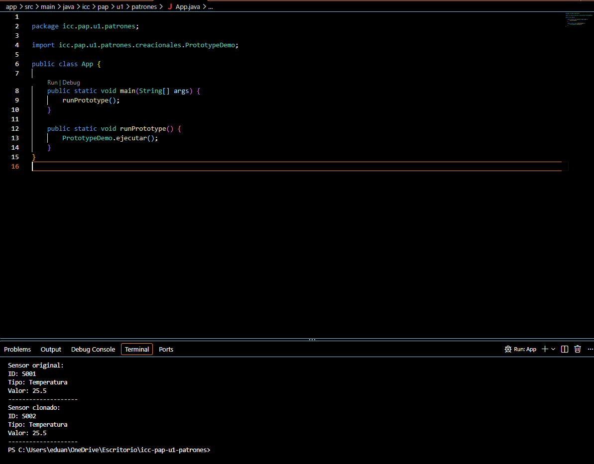

## Explicaion 
//Andres Eduardo Mendez
El patrón Prototype permite crear nuevos objetos copiando un objeto existente, sin necesidad de construirlos desde cero. En este programa se crea un sensor original con el ID S001, tipo Temperatura y valor 25.5. Luego, se clona para obtener otro sensor con la misma información, pero con el ID S002. Así se demuestra que podemos crear copias de objetos y modificar sus datos sin alterar el objeto original.
### Evidencia de ejecución

